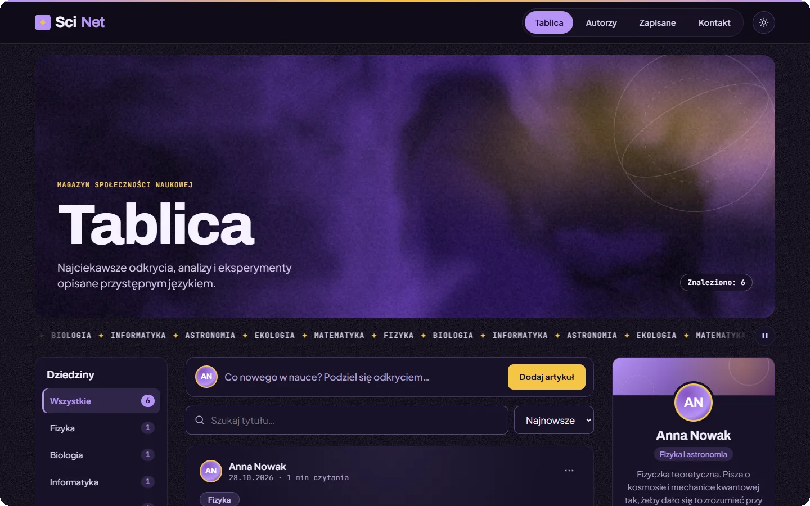
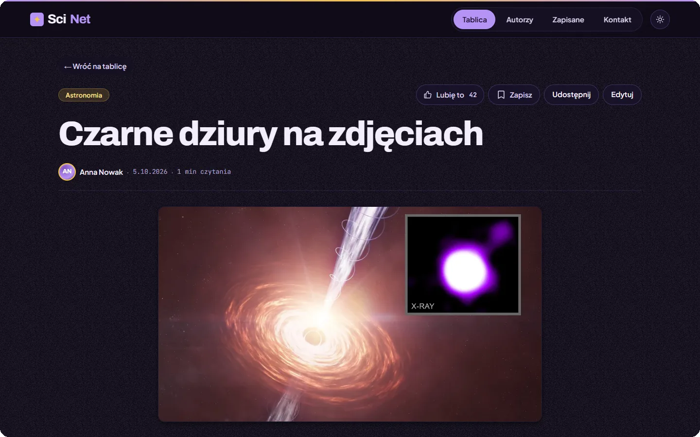
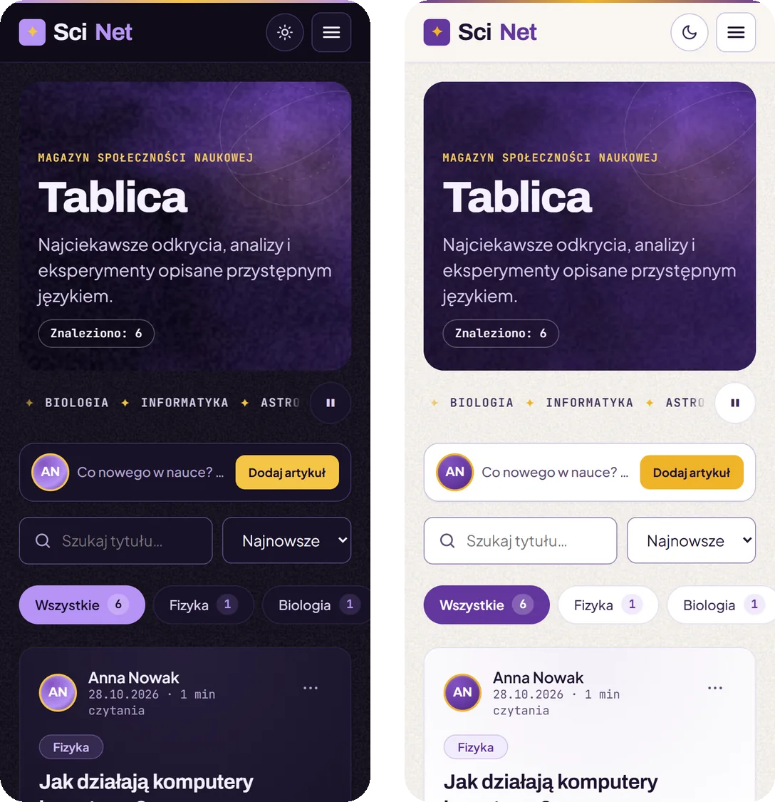

<div align="center">

# ✦ SciNet

**Nauka podana po ludzku.**

Portal społecznościowy dla ludzi nauki. Publikujesz artykuły, czytasz cudze,<br>
dajesz polubienia, komentujesz i zapisujesz te, do których chcesz wrócić.


[Funkcje](#funkcje) · [Wygląd i ruch](#wygląd-i-ruch) · [Jakość](#jakość) · [Uruchomienie](#uruchomienie) · [Jak to jest zbudowane](#jak-to-jest-zbudowane)

</div>

<br>



> [!NOTE]
> Działa w całości w przeglądarce, bez serwera. Przykładowe artykuły, autorzy i dane kontaktowe są zmyślone, a formularz kontaktowy niczego nie wysyła.

## Funkcje

### Czytanie

- **Tablica** z artykułami od najnowszego: szukanie po tytule, dziedziny nauki i sortowanie. Filtry zapisują się w adresie, więc wynik można wysłać linkiem.
- **Strona artykułu** z paskiem postępu czytania, polecanymi tekstami tego samego autora i przyciskiem „Udostępnij”.
- **Zapisane:** własna lista zakładek z licznikiem w menu.
- **Autorzy:** krótkie sylwetki i spis tekstów każdej osoby.

### Pisanie

- **Publikowanie** w formularzu z walidacją: tytuł, autor, dziedzina, treść i opcjonalny obrazek.
- **Edycja i usuwanie** każdego artykułu. Usunięty nie wraca po odświeżeniu.
- **Polubienia** z licznikiem. Drugie kliknięcie cofa polubienie.
- **Komentarze** pod artykułem, z licznikiem na karcie.

### Na co dzień

- **Panele boczne:** wizytówka użytkowniczki i najczęściej polubione artykuły.
- **Dwa motywy:** ciemny „nocne obserwatorium” (domyślny) i jasny, w barwach royal purple, bieli i sunglow gold.
- **Każdy ekran:** trzy kolumny na komputerze, dwie na tablecie i jedna na telefonie.
- **Pamięć w przeglądarce:** wszystko zapisuje się w `localStorage` i zostaje po odświeżeniu strony.

## Wygląd i ruch



| Efekt | Co robi |
| --- | --- |
| **Żywy gradient** | Nagłówek tablicy to shader WebGL rysowany w osobnym wątku. Przyciąga się do kursora i mocniej faluje przy szybkim przewijaniu. |
| **Przejścia stron** | Tytuł i obrazek karty płynnie przechodzą w nagłówek artykułu, a „wstecz” robi ten ruch odwrotnie. Inne strony zmieniają się z krótką kurtyną. |
| **Przewijanie** | Płynne na komputerze. Nagłówek się zwija, karty wchodzą grupami, liczniki doliczają, a duży napis w stopce wyjeżdża na końcu strony. |
| **Typografia** | Tytuły wysuwają się linia po linii, a litery napisu „SciNet” w stopce grubieją pod kursorem. |
| **Detale** | Obrazy falują pod kursorem, przyciski są lekko magnetyczne, a kursor-towarzysz zmienia się w „Czytaj” nad kartą. |

### Na telefonie

<p align="center">
  
</p>

Efekty dopasowują się do urządzenia. Strona sama wybiera jeden z trzech poziomów:

| Poziom | Kiedy | Co dostajesz |
| --- | --- | --- |
| **Pełny** | komputer z myszą | wszystkie efekty |
| **Lekki** | telefon, słabszy sprzęt, oszczędzanie danych | natywne przewijanie, lżejszy gradient, krótsze animacje. Kod kursora i zniekształceń w ogóle się nie pobiera. |
| **Wyłączony** | ustawienie „ogranicz ruch” albo brak WebGL | statyczne tła i natychmiastowe zmiany |

## Jakość

| Lighthouse (wersja produkcyjna) | Komputer | Telefon |
| --- | :---: | :---: |
| Performance | 100 | 92–94 |
| Accessibility | 100 | 100 |
| Best Practices | 100 | 100 |
| SEO | 100 | 100 |

- **Dostępność:** całą aplikację da się obsłużyć klawiaturą, a fokus jest zawsze widoczny. Kontrast tekstu wynosi co najmniej 4,5:1 w obu motywach, także na animowanym gradiencie. Sprawdzone narzędziem axe-core na wszystkich podstronach.
- **Stabilny układ:** nic nie skacze przy wczytywaniu (CLS najwyżej 0,004).
- **Płynność:** najdłuższa klatka przy przewijaniu trwa 7 ms. Biblioteki animacji ładują się dopiero po wyświetleniu strony.
- **Testy:** 384 testy jednostkowe i komponentów (Vitest), do tego sprawdzanie typów i lint.

## Uruchomienie

Potrzebny jest [Node.js](https://nodejs.org/) w wersji `^22.18.0` lub `>=24.12.0`.

```bash
git clone https://github.com/PSkrzyp11/SciNet.git
cd SciNet/scinet
npm install
npm run dev
```

Aplikacja działa pod adresem http://localhost:5173.

<details>
<summary><strong>Wszystkie polecenia</strong> (uruchamiaj w folderze <code>scinet</code>)</summary>

<br>

| Polecenie | Działanie |
| --- | --- |
| `npm run dev` | serwer deweloperski |
| `npm run build` | sprawdzenie typów i wersja produkcyjna |
| `npm run preview` | podgląd wersji produkcyjnej |
| `npm test` | jednorazowe uruchomienie testów |
| `npm run test:watch` | testy uruchamiane przy każdej zmianie |
| `npm run type-check` | samo sprawdzenie typów |
| `npm run lint` | sprawdzenie i poprawa kodu |
| `npm run format` | formatowanie kodu |

</details>

## Jak to jest zbudowane

| Obszar | Narzędzie |
| --- | --- |
| Framework | [Vue 3](https://vuejs.org/) (Composition API, `<script setup>`) |
| Język | [TypeScript](https://www.typescriptlang.org/) |
| Routing i stan | [Vue Router](https://router.vuejs.org/), [Pinia](https://pinia.vuejs.org/) |
| Animacje | [GSAP](https://gsap.com/) (ScrollTrigger, SplitText), [Lenis](https://lenis.darkroom.engineering/), View Transitions API |
| Grafika | WebGL 1 w Web Workerze (OffscreenCanvas), własne shadery, bez bibliotek 3D |
| Fonty | [Fontsource](https://fontsource.org/): Archivo, Plus Jakarta Sans, JetBrains Mono |
| Budowanie i testy | [Vite](https://vite.dev/), [Vitest](https://vitest.dev/), [Vue Test Utils](https://test-utils.vuejs.org/) |
| Jakość kodu | ESLint, Oxlint, Prettier |

<details>
<summary><strong>Struktura folderów</strong></summary>

<br>

```text
scinet/src/
├── assets/       # kafle ziarna tła
├── components/   # karta artykułu, formularze, komentarze, panele, menu
│   └── ui/       # wspólne przyciski, pola, odznaki, okno modalne
├── composables/  # motyw, powiadomienia, animacje przy przewijaniu, poziom efektów
├── data/         # model danych, przykładowe artykuły i autorzy
├── fx/           # efekty WebGL: gradient, fale na obrazach, shadery i workery
├── motion/       # płynny scroll, przejścia stron, poziomy efektów, podział tekstu
├── router/       # adresy podstron i tytuły kart
├── stores/       # stan aplikacji: artykuły i zakładki
├── styles/       # tokens.css (zmienne projektu) i base.css (style bazowe)
├── views/        # całe podstrony, w tym tablica
├── App.vue       # główny układ strony
└── main.ts       # punkt startowy
```

Komponenty dostają dane przez propsy i zgłaszają zmiany przez emity. Dane w store'ach zmieniają dopiero widoki.

</details>

<details>
<summary><strong>Przykładowe dane</strong></summary>

<br>

Przykładowe artykuły z `scinet/src/data/articles.ts` wczytują się tylko przy pierwszym uruchomieniu. Potem aplikacja korzysta z danych zapisanych w przeglądarce, więc po zmianie tego pliku trzeba usunąć klucz `scinet-articles` z `localStorage`. Nową dziedzinę nauki dodaje się do listy `CATEGORIES`.

</details>

## Źródła

Obrazki przykładowych artykułów są w domenie publicznej i pochodzą z Wikimedia Commons: [ilustracja NASA/CXC/SAO](https://commons.wikimedia.org/wiki/File:Artist%27s_illustration_showing_material_in_a_disk_that_is_falling_towards_a_supermassive_black_hole.jpg) i [zdjęcie NOAA Marine Debris Program](https://commons.wikimedia.org/wiki/File:Pre-production_plastic_pellets_(7656726070).jpg). Fonty są na licencji SIL Open Font License.

## Plany

- [x] Testy automatyczne
- [x] Publikowanie, edycja, usuwanie i komentarze
- [x] Polubienia, panele boczne i widok na każdy ekran
- [x] Nowy wygląd: tryb ciemny, animacje, efekty WebGL i przejścia między stronami
- [ ] Publikacja aplikacji w internecie
